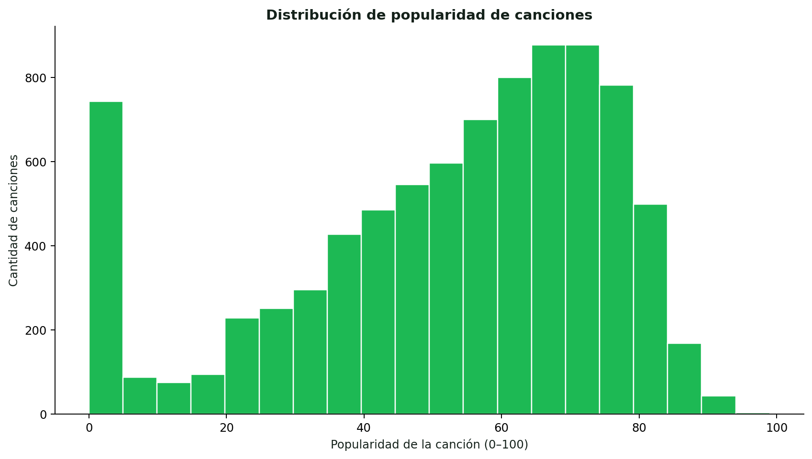
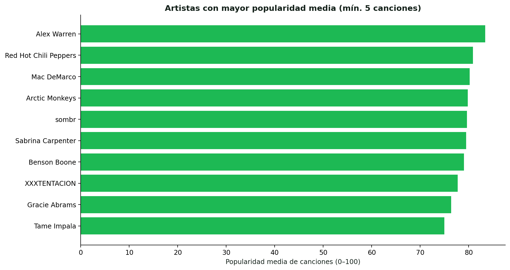
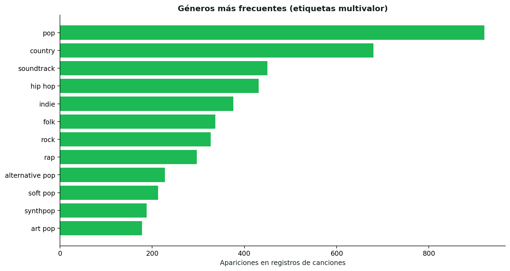
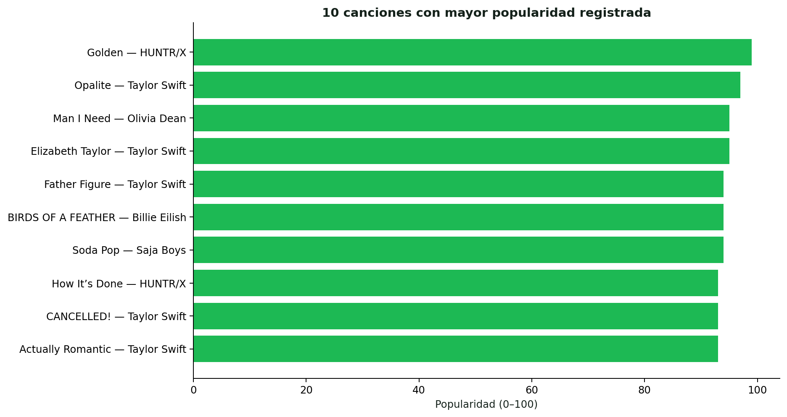
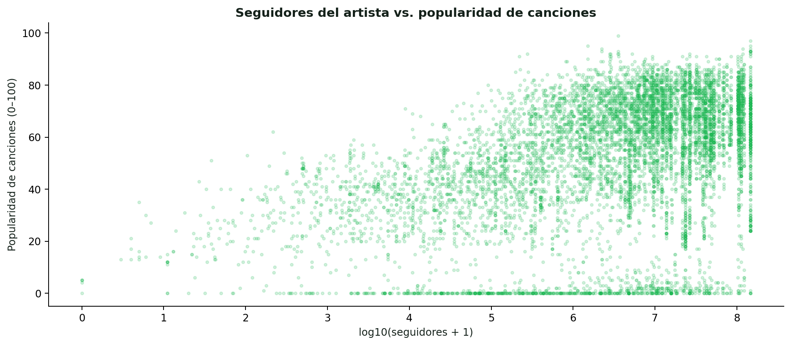

# Spotify EDA | Exploratory Music Analytics 🎧

**Análisis exploratorio de 8,579 registros musicales** con Python, Pandas y Matplotlib. El proyecto transforma una exploración inicial en un flujo reproducible de limpieza, análisis estadístico, visualización y pruebas automáticas.

> **Alcance:** datos históricos de una muestra facilitada por el autor; no se trata de cifras oficiales, en tiempo real ni de todo el catálogo de Spotify. Las visualizaciones del README se construyeron con la muestra original; los datos originales no se comparten por falta de licencia documentada.

## Vista rápida

| Canciones analizadas | Artistas | Popularidad media | Duración media |
|---:|---:|---:|---:|
| **8,579** | **2,547** | **52.36 / 100** | **3.49 min** |

## Visualizaciones



| Top artistas (mín. 5 canciones) | Géneros con más apariciones |
|---|---|
|  |  |

| Canciones más populares | Relación entre seguidores y popularidad |
|---|---|
|  |  |

Otros gráficos: [distribución por año](reports/figures/05_anios.png), [correlaciones](reports/figures/06_correlaciones.png) y [comparación de contenido explícito](reports/figures/08_explicit.png).

## Preguntas analíticas

- ¿Cómo se distribuye la popularidad de las canciones de la muestra?
- ¿Qué artistas tienen mayor popularidad media *con un mínimo de canciones*?
- ¿Qué géneros aparecen con más frecuencia?
- ¿Cómo se relacionan seguidores, popularidad de artista, duración y popularidad de canciones?
- ¿Qué diferencias descriptivas hay entre canciones explícitas y no explícitas?

## Proceso

1. **Carga y validación:** revisión de columnas obligatorias y tipos de datos.
2. **Limpieza:** filas sin identificadores críticos, IDs duplicados, puntuaciones fuera de rango y fechas no interpretables.
3. **Análisis:** estadísticas descriptivas, rankings con tamaño mínimo de muestra y correlaciones de Pearson.
4. **Visualización:** 8 gráficos reproducibles exportados a PNG.
5. **Calidad:** pruebas con Pytest y ejecución automática en GitHub Actions.

## Tecnologías

`Python` · `Pandas` · `NumPy` · `Matplotlib` · `Jupyter Notebook` · `Pytest` · `GitHub Actions`

## Estructura

```text
spotify-eda/
├── spotify_eda/           # Carga, limpieza, métricas y gráficos
├── scripts/run_analysis.py
├── notebooks/Spotify_EDA.ipynb
├── data/                  # CSV de demostración ficticio
├── reports/
│   ├── figures/           # 8 visualizaciones de la muestra original
│   ├── RESULTADOS.md      # Conclusiones y limitaciones
│   └── metrics.json
├── tests/                 # Pruebas unitarias
├── .github/workflows/     # CI
└── requirements.txt
```

## Cómo ejecutarlo

```bash
# 1. Crear entorno virtual
python -m venv .venv

# Windows:
.venv\Scripts\activate
# macOS / Linux:
# source .venv/bin/activate

# 2. Instalar librerías
pip install -r requirements.txt

# 3. Ejecutar con CSV ficticio incluido
python scripts/run_analysis.py --data data/spotify_demo.csv --output reports_demo

# 4. Para analizar el CSV original obtenido legalmente:
python scripts/run_analysis.py --data data/spotify_data.csv --output reports
```

También puedes abrir `notebooks/Spotify_EDA.ipynb` y ejecutar las celdas desde la raíz del repositorio. Por defecto utiliza el CSV ficticio de demostración.

### Pruebas automáticas

```bash
pip install -r requirements-dev.txt
python -m pytest -q
```

## Hallazgos y límites del análisis

El dataset registra **25.03%** de canciones marcadas como explícitas; **39.14%** no tienen información de géneros asignada. Para los resultados completos consulta [RESULTADOS.md](reports/RESULTADOS.md).

**Importante:** no se puede inferir causalidad de correlaciones ni extrapolar esta muestra al catálogo global. Los seguidores y puntuaciones representan los valores del CSV, no valores actuales de la plataforma.

## Autor y uso

Proyecto de portafolio de **análisis exploratorio de datos y visualización**. Los archivos de demostración son ficticios. Revisa [derechos y procedencia](LICENSE-NOTICE.md) antes de publicar o redistribuir datos del proveedor. Proyecto independiente, sin afiliación con Spotify.
